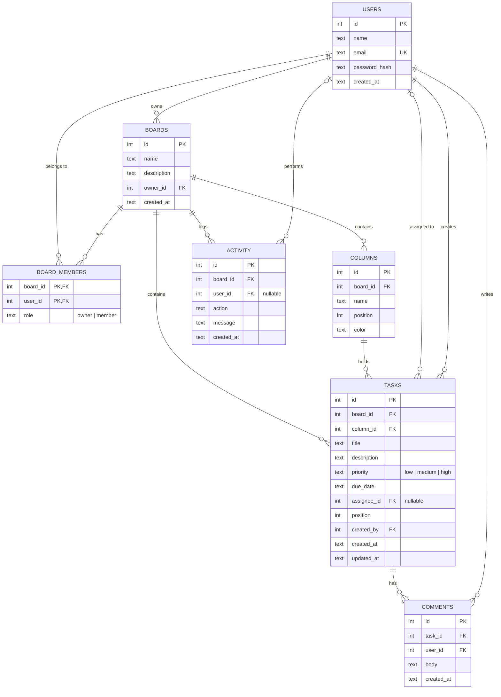

# Data model (MongoDB collections)

Each entity is a collection whose `_id` is an integer from the `counters` collection (`{_id: <collection>, seq}`). The API exposes it as `id`. Relationships are id references, and the app enforces cascades.

## Cascade rules
| Delete | Effect |
|---|---|
| Board | Its members, columns, tasks, comments, and activity are deleted |
| Column | Its tasks and their comments are deleted |
| Task | Its comments are deleted |
| User | Assigned tasks become unassigned (`SET NULL`) |
| Member removed from board | Their assignments on that board are cleared |
